# Issue #2 visual evidence — 2026-11-17

Environment: Pop!_OS 22.04, X11, Flutter 3.44.4 / Dart 3.12.2, display scale 1. Working tree on `feat/2-camera-connection`, based on `d0a92cbaa76b4df39f5cb3da5a39f618646ee97b`; not yet committed or published. SHA-256 of sorted relative file paths and bytes under `lib/`, non-ephemeral `linux/`, and `test_support/`: `ff98cb762bf8eab52ef0c48f63e9fd8f235ac79e2091902413fddd8fbdd0261f`. Revision-specific PR image URLs remain pending publication.

| Image | Scenario and expected result | Observed result |
| --- | --- | --- |
| [Selection, large](selection-1000x700.png) | Gallery-first; explicit camera selection, status text, no claimed connection; 1000 × 700 Flutter content | Native pointer selection works; selected radio/text and disabled Pair explanation visible; no clipping/overlap. App-only PNG is 1052 × 799 including GTK header and shadow. |
| [Selection, small](selection-640x480.png) | Same selection state, resized to 640 × 480 Flutter content | Text/control layout fits after redraw; app-only PNG is 692 × 579 including GTK header and shadow. |
| [Approval error](discovery-approval-error.png) | Safe normal launch cannot scan; clear error and Retry | Error text/Retry visible; activating Retry leaves authorization boundary in place; no scan. 1000 × 700 content / 1052 × 799 PNG. |

Selection images use `flutter run -d linux -t test_support/gallery_preview.dart` and **simulated discovery**. Approval-error image uses normal `flutter run -d linux` with discovery disabled. No real camera data or personal media. Images were captured with `import -window <app-window-id> <path>` and opened/visually inspected. Native window geometry was checked with `xwininfo`; resize used `xdotool windowsize` on the app window. No desktop-wide capture.

Running-app `integration_test` checks separately passed keyboard camera selection at both Flutter layout constraints and keyboard Retry recovery using simulated discovery. Native synthetic keyboard selection did not reliably change the selection during screenshot capture; native pointer selection was used for those images. Do not infer keyboard operation from screenshots. Focus feedback was visible on the camera row, but native keyboard behavior still needs the joint walkthrough; no full accessibility audit. Pair remains disabled and its keyboard activation cannot yet be verified.

Progress, no-camera, connected and other failure screenshots are not claimed here. Pairing, keyring, networking and actual camera evidence remain pending. Transient resize/capture redraw artifacts were resolved before retaining the final small screenshot.

## Joint filtered discovery — 2026-11-17

The owner approved the proposed discovery run and confirmed the camera was powered on beside the PC. Ran `flutter run -d linux --dart-define=CAMERA_DISCOVERY_APPROVED=true` once. Expected: finish one 10-second service-filtered LE collection window and show matching candidates or a clear failure. Observed: the app displayed **one candidate**, generically labeled `YI M1 1`, with camera selection and Pair disabled. The screenshot was captured with app-window-only ImageMagick `import`, opened and inspected; no private identifier is displayed. The UI did not claim Connected or an empty card. The app was then stopped to prevent unintended further interaction. No Retry or second scan was initiated by the agent.

[Inspected discovery screenshot](real-discovery-candidate.png), real host BlueZ data, not the simulated fixture. Capture: 1052 × 799 pixels including GTK header/shadow, approximately 1000 × 700 Flutter content at scale 1, Pop!_OS 22.04 X11. Working tree `feat/2-camera-connection`, base `d0a92cbaa76b4df39f5cb3da5a39f618646ee97b`, uncommitted. SHA-256 over sorted relative paths and bytes under `lib/` and non-ephemeral `linux/`: `47248fd82a8bda7e66fb36a71fcf5a0db6d8bb713235016c6853aa308e1ec901`. Recorded at 2026-11-17T20:18:47.831586+00:00.

Outcome: **real discovery path exercised successfully; one candidate returned**. The adapter includes matching cached BlueZ devices, so this does not prove a fresh advertisement, unique camera identity, firmware, current GATT reachability or a complete connection. No GATT connection, characteristic read/write, notification subscription, pairing, keyring operation or Wi-Fi change was performed. No native authorization dialog was observed by the agent; camera-screen observations have not been independently established.

Next proposed check (not authorized or implemented yet): connect only to the selected candidate for GATT enumeration, inspect characteristic properties and read only firmware-info `41106da2-25ad-477b-a884-5038b6de4649` if readable, then disconnect. No characteristic writes/subscriptions, pairing, credentials, Wi-Fi activation or keyring operations. Prepare/review the exact command and scoped tooling before execution; stop if an unexpected pairing/authorization prompt appears.

## Simulated Pair UI — 2026-11-17

[Selected camera with Pair](pair-selection-1000x700.png): actual Linux app, simulated discovery/storage/pairing. Expect explicit selection and replacement warning before enabled Pair; observed selected radio, warning and enabled Pair, with no clipping at 1000 × 700 content. PNG is 1052 × 799 including GTK decorations/shadow.

[Waiting for approval](pair-approval-640x480.png): same real app and simulated boundaries after keyboard Pair. Expect clear approval text/progress without Connected; observed that state with no overlap at 640 × 480 content. PNG is 692 × 579 including decorations/shadow. App-only ImageMagick captures were opened and visually inspected. A temporary integration-test checkpoint drove keyboard selection/Pair and paused for capture; the checkpoint source is retained only as an ignored local research artifact, not a blocking test in the normal suite.

Snapshot: uncommitted branch `feat/2-camera-connection`, base `d0a92cb`; source digest over sorted relative paths/bytes under lib/non-ephemeral linux/test_support: `c6e43a3ef987ea20d4511031baa38c257683ad23dec16bb39d06bccd6341b29b` (after application safety fixes). No real approval command, token, credential or keyring access. Earlier discovery-only images remain historical and show disabled Pair, not the current opt-in pairing fixture. PR publication remains pending.

## Joint BLE session result — 2026-11-17

The owner explicitly approved trying pairing and confirmed the camera powered on. Ran `flutter run -d linux --dart-define=CAMERA_DISCOVERY_APPROVED=true --dart-define=CAMERA_PAIRING_APPROVED=true` on the target Pop!_OS 22.04 desktop. Expected: authorized first pairing or safe remembered reuse, then a session response without Wi-Fi activation/association. The owner supplied a screenshot of **“Pairing saved and BLE session verified. Wi-Fi connection is not implemented yet.”** The agent independently captured the same actual app window and visually inspected it: [BLE session result](real-ble-session-result.png), no secrets or identifiers displayed, clear status with no clipping.

Observed result: the real UI reached its BLE-session success path. The implementation reaches this state after reading fresh camera Wi-Fi credentials through `da6` following `da4` session setup and finding/persisting pairing material via the app keyring. Credentials were not logged or published. No `da5` Wi-Fi activation, network association, HTTP or media operation exists in this path.

Important limit: the success text is shared by first-time pairing and remembered-session reuse. Camera-screen approval, whether the owner selected Pair, and native keyring prompts have not yet been confirmed. Therefore this screenshot does **not** independently prove a new `da0` pairing, camera-screen confirmation, a fresh keyring write, or persistence across app restart. Those distinctions remain pending owner confirmation and a separately agreed restart/reuse test. Firmware 3.2-int remains owner-reported; no raw firmware record was exposed. No automatic re-pair or retry was initiated by the agent.

Revision: uncommitted `feat/2-camera-connection`, base `d0a92cb`, SHA-256 sorted relative paths/bytes for lib and non-ephemeral linux: `c6ec7a0e551c77367024a404e4f1130f615585860da623554a7901dae2f6235d`. Capture 1052 × 799 pixels including GTK header/shadow, approximately 1000 × 700 content, display scale 1, X11. The app remains idle at the result screen; adapter cleanup attempts disconnect before returning. Successful real-daemon resource release is not independently measured. Required keyring failure/prompt checks, restart reuse, full deadline, Wi-Fi and HTTP acceptance remain pending. Overall issue #2 remains incomplete.

## Owner confirmation — first Pair, failure, then Retry

The owner confirmed selecting **Pair** and approving the request on the camera screen during the joint 2026-11-17 run. The first app attempt failed; after the owner pressed **Retry**, the app reached the previously captured BLE-session success screen. This confirms actual user-authorized new pairing was initiated and camera-screen approval occurred. The successful Retry is consistent with storage/session recovery without a fresh pairing, but the first error and whether a second camera approval occurred have not been established. Do not infer the failed step, root cause, absence of repeated pairing, or uninterrupted first-attempt success from the final screenshot. Preserve the initial failure as part of the hardware evidence. Restart persistence, Wi-Fi and HTTP acceptance remain pending. No additional camera action was initiated by the agent while collecting this account.

Next question: what exact error appeared on the first attempt? Do not reproduce the failure by pairing again merely to obtain the message.

## Remembered restart test — failed at camera lookup

On 2026-11-17, the owner approved restarting only to verify saved pairing reuse, without a new Pair action or Wi-Fi changes. The agent stopped the previous app and launched the pairing-enabled app again. No Pair or Retry was pressed by the agent. Observed error: **“Camera session failed while finding the selected camera. Select Retry to reuse the remembered pairing.”** The actual app screenshot was captured and visually inspected: [restart lookup failure](real-restart-lookup-failure.png). No identifiers/secrets displayed.

**Outcome: restart reconnection failed.** The stage proves the app read and decoded a remembered record through the app keyring on the new process and entered `resume`, but did not resolve exactly one matching cached BlueZ device. It does not prove invalid pairing or an expired token. No new-pairing write or camera session write was issued on this failed path. Wi-Fi remained unchanged. The earlier first-attempt failure's cause is still unknown; the owner cannot recall its message. Do not claim it had this same cause.

Source inspection: current resume lookup requires stored address, address type and M1 UUID on the BlueZ cache, without rediscovery. Possible causes include a missing cached device/service, identity change, or camera availability; no raw cache/secret inspection or further hardware test ran to choose among them. Offline diagnosis/regression work follows before requesting another joint run. C2 automatic reconnect remains failed/pending, not passed. App-keyring record survival across this process restart is observed; locked/unavailable behavior remains unverified.

## Remembered restart retest — BLE session succeeded (2026-11-17)

The owner approved a new app launch with the lookup correction, including up to 10 seconds of filtered LE rediscovery if needed. On this fresh process, the actual Linux app reached **“Pairing saved and BLE session verified. Wi-Fi connection is not implemented yet.”** without the agent pressing Pair or Retry. The owner independently confirmed that result. The screenshot was captured and visually inspected; it contains no device identifiers or credentials.

This verifies saved app-keyring material survived process restart and was reused successfully for a BLE session on the owner's camera in this run. The launch path reads the stored record and resumes the session; it does not initiate new pairing or replace the stored record. No Wi-Fi changes were made. The screenshot and app result do not establish whether the optional rediscovery branch ran, or which lookup weakness caused the earlier failure. The camera was not power-cycled for this test.

The earlier failed restart remains part of the evidence. This success covers the remembered BLE-session portion only, **not full C2 connection acceptance**: Wi-Fi activation/association and HTTP reachability remain unimplemented. Locked/unavailable keyring behavior and clean first-pair completion remain unresolved. No additional tests were initiated after the successful authorized restart.

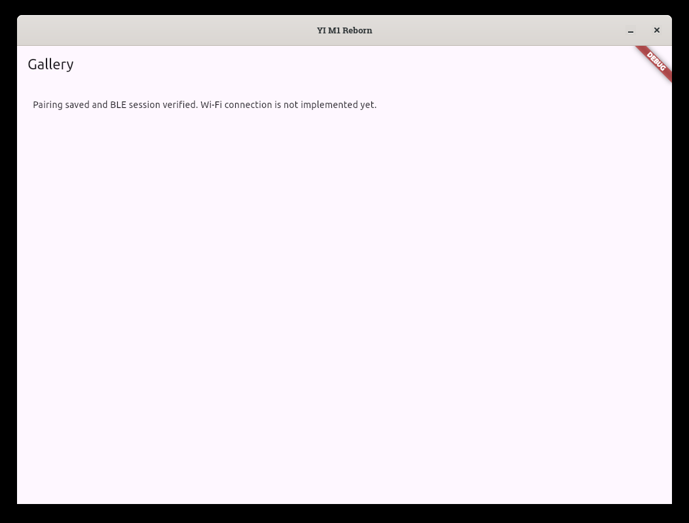

## Offline connection UI checks — 2026-11-17

The actual Linux Flutter app ran `test_support/connection_preview.dart` with simulated pairing, storage, network and camera-response boundaries. No real camera, keyring or host NetworkManager operation ran. `PREVIEW_STATE` selected connected, response-progress and failure states. At requested GTK content sizes 1000 × 700 and 640 × 480, text/Retry remained readable without clipping. App-window-only ImageMagick captures were visually inspected. The window decorations/shadow can make captured pixels differ from the requested content size; no desktop/other-app content or identifiers appear.

The four Linux integration tests pass, including simulated response failure → keyboard Retry → Connected; they establish application behavior, not actual hardware response. A manual keyboard Tab/Return also activated Retry in the error fixture. The connected state explicitly says filenames are not loaded. Screenshot source fingerprint (paths in `lib/presentation`, use case, network contract and the fixture sources): `d80349133e3ba4f12bc0cb0062f004ee4d5712dc08e2c2e5237364f4c31211a7`; base commit `d0a92cb`, working tree uncommitted. Images remain local until separately authorized publication. Earlier real BLE results are separate evidence.

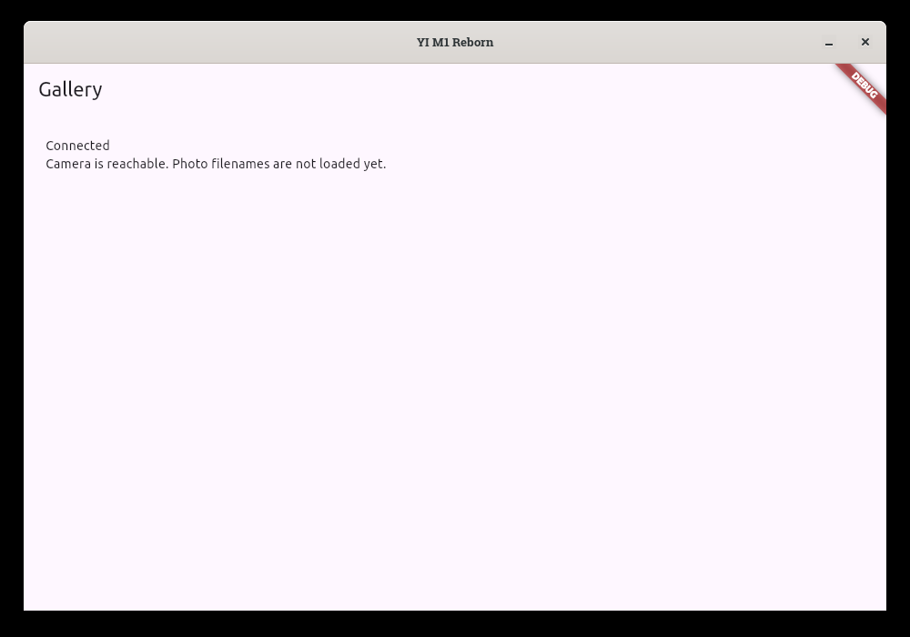
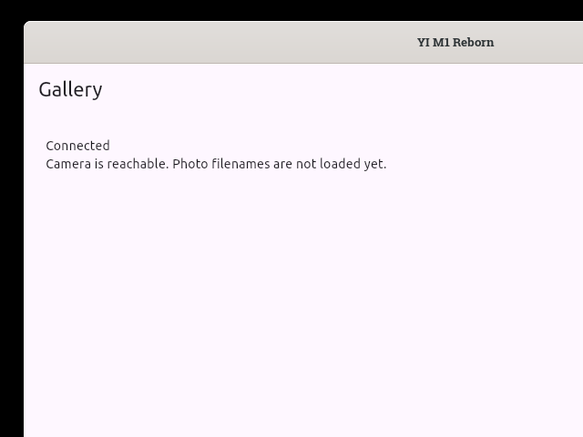
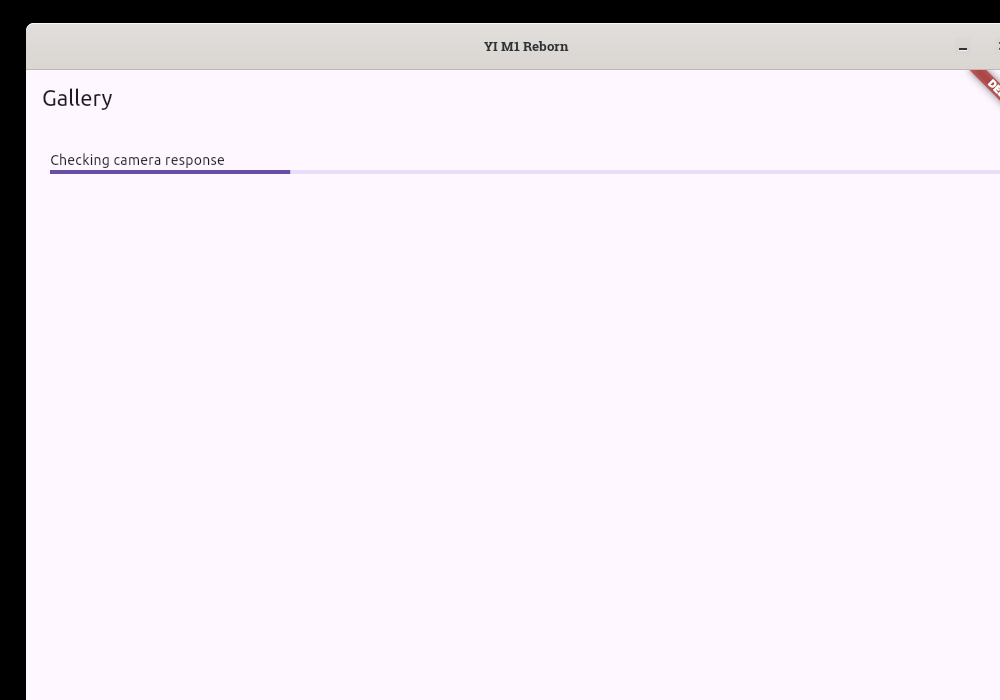
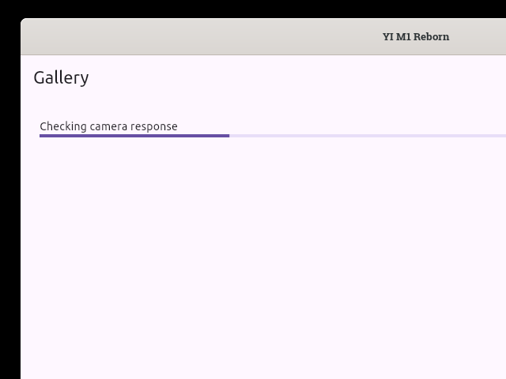
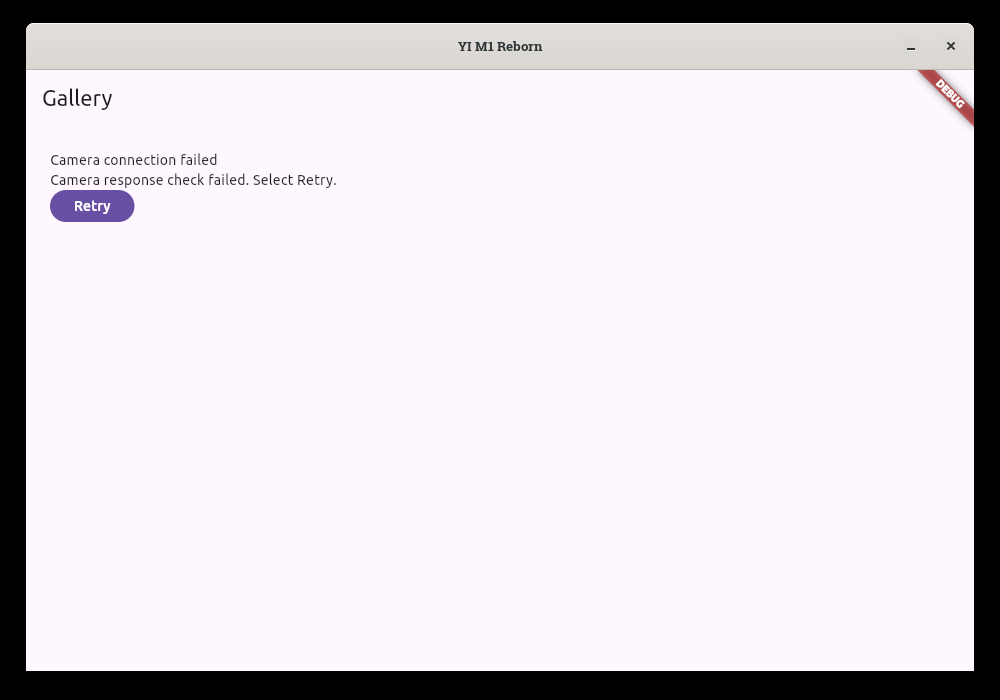
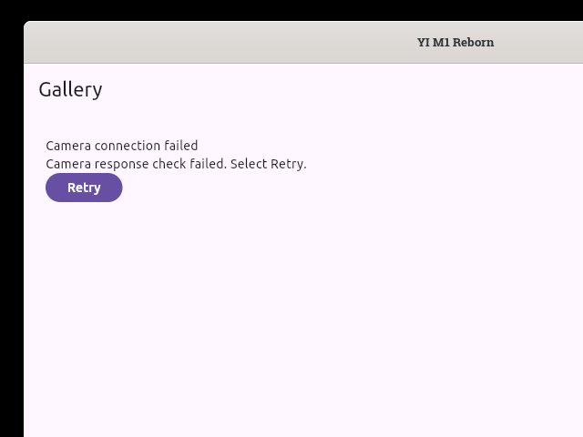

### Link-loss cleanup follow-up

The simulated running Linux app also exercised known network loss while cleanup was pending. Connected disappeared, “Releasing camera network” was readable, and Retry was withheld until cleanup. The 640 × 480 capture below was inspected. A larger capture taken before repaint was discarded; do not count it as large-size link-loss evidence. This additional state has widget and isolated D-Bus coverage; it is not a real link-loss test.

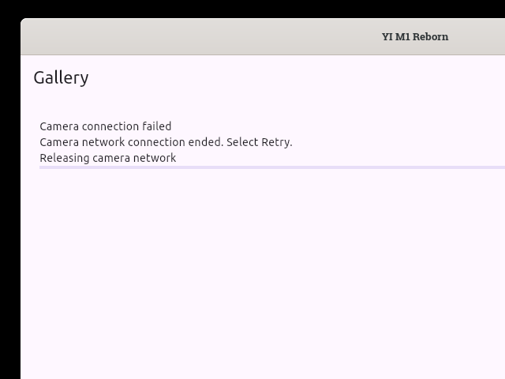

## Joint network-enabled attempt — 2026-11-18

Owner approved saved-pairing reuse, camera AP enable, automatic Wi-Fi association and one read-only status check, and confirmed the camera ready. Started at `2026-11-18T05:25:04.126126+00:00`; source/test SHA-256 `23a908e1d82d04b84b536603be37909d58937ff7f5a3bf584fac87d814b49bf7`, uncommitted branch `feat/2-camera-connection`, base `d0a92cb`.

The actual app displayed “Camera connection failed” / “Camera Wi-Fi connection failed. Select Retry.” The owner reported the camera displayed Wi-Fi connection in progress. The app screenshot was captured and inspected. This records failure at the Wi-Fi step, not its root cause or successful association. No successful HTTP status check or full Connected result is established. No new Pair was selected in this attempt. Keyring prompts and network setup were not recorded, so neither is inferred.

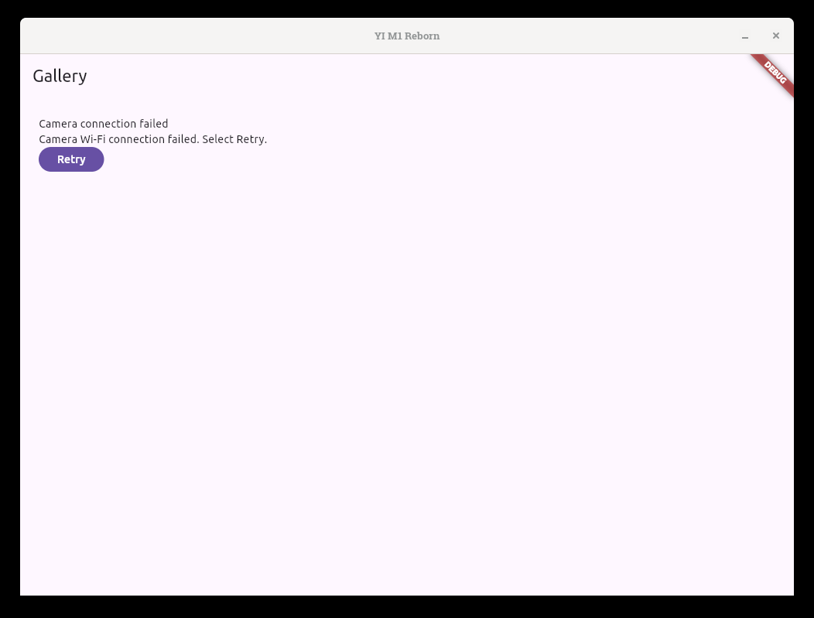

The owner reported that the single agreed manual Retry also failed. No diagnostic cause was captured: runtime output contained startup/build information only. The prior implementation translated all NetworkManager errors to one generic Wi-Fi failure. The real test app was stopped before offline observability/error-handling corrections; no further Retry or camera operation ran.

## Offline observability and fatal-error UI — 2026-11-18

Source/test SHA-256 `c7dadb9429f2995afc8db1c45a2e2313fbccaf9abfad9be56d2317b3d0cf3c10` (sorted relative Dart paths plus contents under lib/test/integration_test/test_support), uncommitted base `d0a92cb`. Actual Linux app fixture `connection_preview.dart`, `PREVIEW_STATE=unexpected`, simulated boundaries only. Injected StateError is reported, the spinner stops, readable unexpected-error text appears, and no ordinary Retry is offered. Launched, resized to 1000 × 700 and 640 × 480, Tab pressed, app-window screenshots captured with ImageMagick import and visually inspected. Safe JSON error output was observed with runtime type/code locations only. No real camera, system bus, NetworkManager or keyring operation ran. Evidence is local, not PR-embedded.

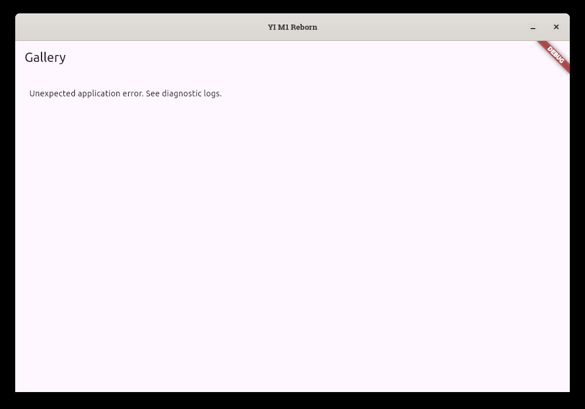

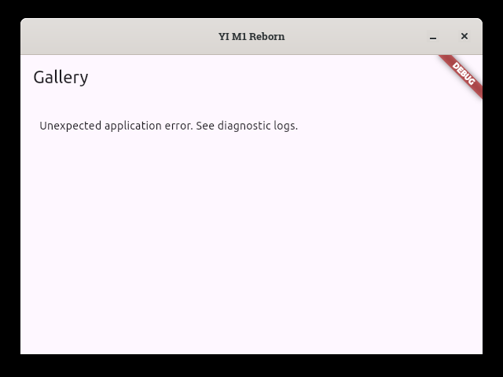
