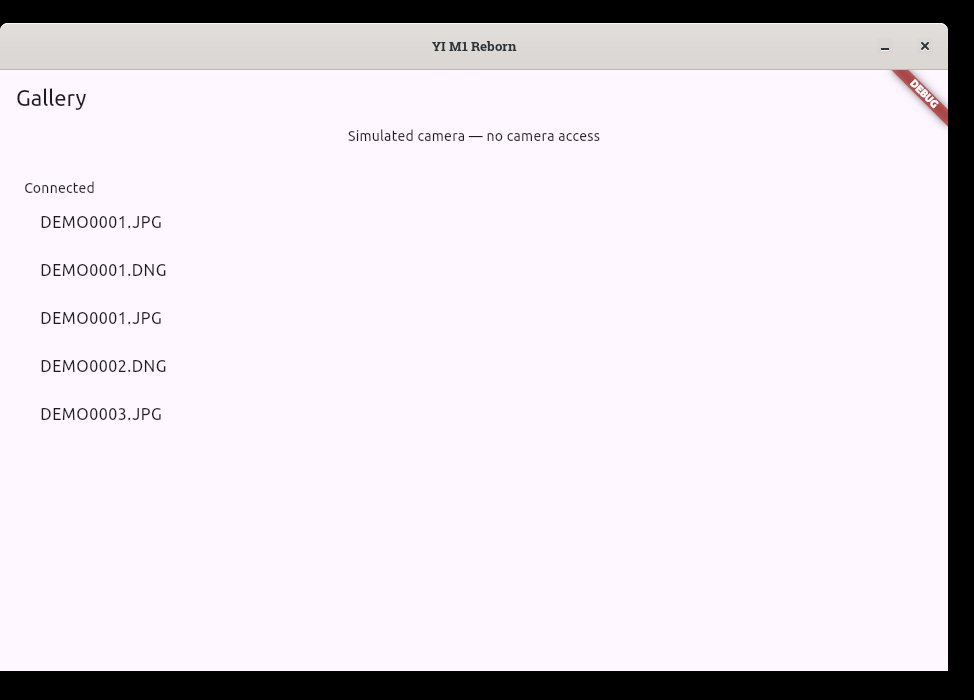
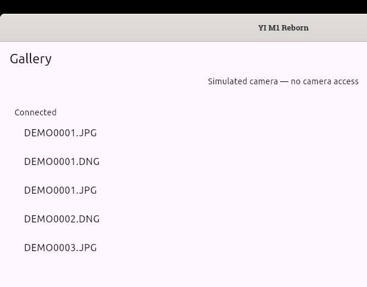
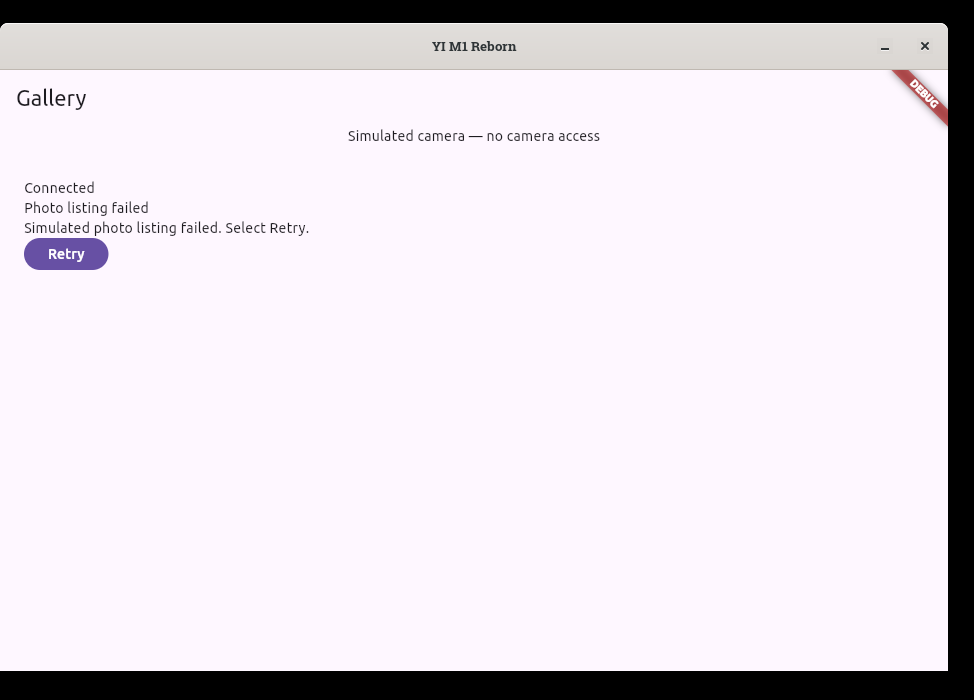
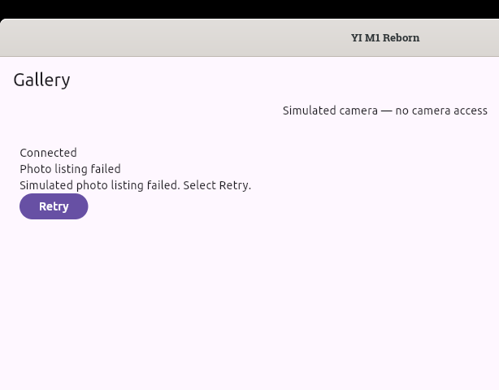

# Issue #3 offline Gallery evidence

Publication note: this evidence is included in the owner-authorized combined development draft PR. Dated “local/not pushed” statements below describe capture-time status, not hardware acceptance. PR image URLs are pinned to the publication commit; capture revisions/source hashes below remain the authority for what was actually exercised.

All images here use synthetic metadata and a simulated connection, not the owner's camera. The actual Linux Flutter app is launched through `lib/main_simulated.dart`; the visible “Simulated camera — no camera access” label stays on screen. No image bytes, BLE, host networking or keyring are used.

Expected layout: Gallery title, simulation notice and text connection status above the shared content area. Populated rows show filenames only; RAW+JPEG and same-named files in different synthetic locations remain separate. Loading is not empty success; a successful empty catalog says “No photos”; a managed failure offers manual Retry on the existing session.

Images are app-window-only ImageMagick `import` captures. Each was opened and inspected for readable content, no overflow and no private data. Target content sizes are 1000 × 700 and 640 × 480 logical pixels; window decoration is included by capture. Keyboard Retry passed in the SDK running-Linux integration test; native xdotool activation was inconclusive (details below). These images do not prove real connection, wire parsing, pagination, timestamp meaning or camera compatibility.

## Captures

Source/test SHA-256: `f61dcd55af870f06b7b35c7c670a9bd886b56dd8f2c30805c534eff5b171d120` (all Dart files sorted by relative path plus contents). Branch `feat/3-gallery-filenames`, local base `4b43b2c`; #3 working changes uncommitted. No evidence pushed or PR-embedded.

## Captures and outcomes — 2026-11-18

- Populated catalog at both sizes: synthetic rows, separate JPEG/RAW and duplicate names with separate identity; text readable and no overflow observed.
- Managed listing error at both sizes: Connected status remains distinct from listing failure; Retry is visible. An `xdotool` keyboard activation attempt did not change this fixture's state, so it is not claimed as successful manual keyboard evidence. The SDK Linux integration journey did pass keyboard Retry at both sizes, including recovery to rows.
- Loading native-window capture was attempted but the desktop/lock overlay obscured the app. Those captures were discarded; loading/empty native-window screenshots remain pending an accessible desktop. No unlock or security-policy change was attempted. Widget tests cover loading→empty and cancellation; this is not a substitute for missing native evidence.

